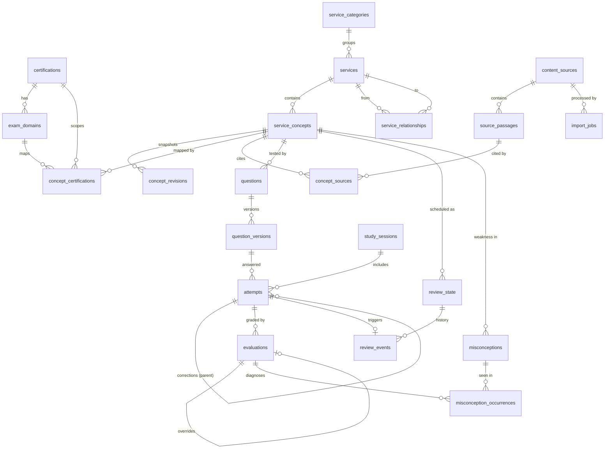

# Data Model

**Status:** Draft for approval. **No migrations are written until this document is approved** (brief §6).
Column lists are specifications. The illustrative SQL is non-final.

## 1. Conventions

| Convention | Rule |
|---|---|
| Primary keys | `uuid` with `default gen_random_uuid()`. Join tables use composite PKs. |
| Timestamps | `timestamptz`, written as UTC (`now()`). Mutable tables have `created_at` and `updated_at`, maintained by a trigger. Append-only tables have `created_at` only. |
| Enums | Postgres `text` + `CHECK` constraints (easier to evolve than native enums). Listed values are exhaustive for the MVP. |
| Ownership | Learner data has `user_id uuid not null references auth.users`. Catalog data has `owner_id` (author) and `visibility`. |
| Soft lifecycle | Content uses `status` (`draft` → `in_review` → `published` → `retired`). Published learning content is never hard-deleted while referenced. |
| Text limits | Learner answers ≤ 8,000 chars; titles ≤ 200 chars; enforced with `CHECK (char_length(...) <= n)`. |
| JSON | Allowed only for validated, versioned documents (rubric, AI feedback, scheduler config, job cursor), never for relational data. |

## 2. Entities

The 16 entities from the brief, plus **6 additions** that are needed for normalization or versioning. The additions require approval (checklist A3).

| Entity | Group | Note |
|---|---|---|
| certifications | Catalog | |
| exam_domains | Catalog | |
| **service_categories** | Catalog | *Added.* Categories as data, not a hardcoded enum. Works across clouds. |
| services | Catalog | |
| **service_relationships** | Catalog | *Added.* "Link related services" (LIB-6) and future Architecture Lab swaps. |
| service_concepts | Catalog | |
| **concept_revisions** | Catalog | *Added.* Append-only snapshot of each published concept revision (content versioning). |
| concept_certifications | Catalog | |
| content_sources | Content | |
| source_passages | Content | |
| concept_sources | Content | |
| questions | Catalog | Stable identity, status, current version pointer. |
| **question_versions** | Catalog | *Added.* Immutable prompt + reference answer + rubric. Attempts reference the exact version graded (rubric versioning). |
| study_sessions | Learning | |
| attempts | Learning | |
| evaluations | Learning | |
| review_state | Learning | |
| review_events | Learning | |
| misconceptions | Learning | |
| **misconception_occurrences** | Learning | *Added.* Links a misconception to each evaluation that diagnosed it, so recurring patterns can be tracked. |
| import_jobs | Content | |
| **user_settings** | Learning | *Added.* Timezone, AI toggle, limits, scheduler config overrides. |

## 3. Entity relationship diagram



## 4. Table specifications

### 4.1 Catalog

**certifications**
| Column | Type | Constraints |
|---|---|---|
| id | uuid | PK |
| vendor | text | `CHECK (vendor IN ('aws','gcp','azure'))` |
| code | text | e.g. `SAA` |
| exam_version | text | e.g. `C03` |
| name | text | not null |
| status | text | `active` \| `retired` |
| exam_guide_url | text | nullable |
| created_at, updated_at | timestamptz | |
| | | `UNIQUE (vendor, code, exam_version)` |

**exam_domains**
| Column | Type | Constraints |
|---|---|---|
| id | uuid | PK |
| certification_id | uuid | FK → certifications, not null |
| code | text | e.g. `D1` |
| name | text | not null |
| weight_pct | numeric(5,2) | `CHECK (weight_pct BETWEEN 0 AND 100)` |
| sort_order | int | |
| | | `UNIQUE (certification_id, code)`, `UNIQUE (id, certification_id)` (target for composite FK) |

**service_categories**: `id`, `slug UNIQUE`, `name`, `sort_order`.

**services**
| Column | Type | Constraints |
|---|---|---|
| id | uuid | PK |
| cloud_provider | text | `aws` \| `gcp` \| `azure` |
| slug | text | `UNIQUE (cloud_provider, slug)` |
| name | text | e.g. "AWS Lambda" |
| aliases | text[] | e.g. `{ELB}`; GIN-indexed |
| category_id | uuid | FK → service_categories |
| what_it_is_md, how_it_works_md, problem_solved_md, how_it_solves_md, does_not_do_md, when_to_choose_md, architecture_placement_md, trade_offs_md | text | The eight mastery dimensions (PRD §2). Nullable; the UI shows "Not yet authored". |
| docs_url | text | |
| status | text | content lifecycle |
| search_tsv | tsvector | generated from name, aliases, and summary |
| created_at, updated_at | timestamptz | |

**service_relationships**: `from_service_id`, `to_service_id`, `relation` (`alternative_to` \| `commonly_paired_with` \| `prerequisite_for` \| `often_confused_with`), `note_md`.
PK `(from_service_id, to_service_id, relation)`, `CHECK (from_service_id <> to_service_id)`.

**service_concepts**
| Column | Type | Constraints |
|---|---|---|
| id | uuid | PK |
| service_id | uuid | FK → services, not null |
| slug | text | `UNIQUE (service_id, slug)` |
| title | text | e.g. "Concurrency" |
| summary_md, explanation_md, examples_md, limitations_md | text | |
| status | text | `draft` \| `in_review` \| `published` \| `retired` |
| origin | text | `curated` \| `ai_draft` \| `manual` |
| visibility | text | `shared` \| `private` |
| owner_id | uuid | FK → auth.users |
| revision | int | `default 1`; incremented on publish |
| published_at | timestamptz | `CHECK (status <> 'published' OR published_at IS NOT NULL)` |
| search_tsv | tsvector | generated |
| created_at, updated_at | timestamptz | |

**concept_revisions** (append-only): `id`, `concept_id`, `revision`, `snapshot jsonb` (all content fields + citation ids), `published_by`, `created_at`. `UNIQUE (concept_id, revision)`.

**concept_certifications**
| Column | Type | Constraints |
|---|---|---|
| concept_id | uuid | FK → service_concepts |
| certification_id | uuid | |
| exam_domain_id | uuid | composite FK `(exam_domain_id, certification_id) → exam_domains(id, certification_id)` guarantees the domain belongs to the certification |
| relevance | text | `core` \| `supporting` |
| | | PK `(concept_id, exam_domain_id)` |

**questions**
| Column | Type | Constraints |
|---|---|---|
| id | uuid | PK |
| concept_id | uuid | FK → service_concepts |
| question_type | text | `open_recall` (MVP); `scenario` is reserved for the Architecture Lab |
| dimension | text | one of the 8 dimensions: `what`, `how`, `problem`, `solution`, `not_do`, `when`, `where`, `trade_offs` |
| difficulty | smallint | `CHECK (difficulty BETWEEN 1 AND 3)` |
| status | text | lifecycle |
| origin | text | `curated` \| `ai_draft` \| `manual` |
| current_version_id | uuid | FK → question_versions, `DEFERRABLE INITIALLY DEFERRED` |
| created_at, updated_at | timestamptz | |

**question_versions** (immutable once referenced by an attempt; enforced by trigger)
| Column | Type | Constraints |
|---|---|---|
| id | uuid | PK |
| question_id | uuid | FK → questions |
| version | int | `UNIQUE (question_id, version)` |
| prompt_md | text | not null |
| reference_answer_md | text | not null; **never selected by the client before submission** (§6.3) |
| rubric | jsonb | validated against `rubric_schema_version` (GRADING_RUBRICS §3) |
| rubric_schema_version | int | |
| created_at | timestamptz | |

### 4.2 Content

**content_sources**
| Column | Type | Constraints |
|---|---|---|
| id | uuid | PK |
| owner_id | uuid | FK → auth.users |
| source_type | text | `aws_documentation` \| `aws_whitepaper` \| `aws_faq` \| `curated` \| `user_note` \| `user_upload` |
| visibility | text | `shared` \| `private`. `user_note`/`user_upload` are always `private` (CHECK). |
| title | text | |
| url | text | required for `aws_*` types (CHECK) |
| storage_path | text | required for `user_upload` (CHECK); `sources/{owner_id}/{id}.pdf` |
| mime_type, byte_size, sha256, page_count | | `UNIQUE (owner_id, sha256)` prevents duplicate uploads |
| note_body_md | text | for `user_note` |
| retrieved_at | timestamptz | when an AWS page was captured |
| status | text | `pending` \| `ready` \| `failed` \| `archived` |
| created_at, updated_at | timestamptz | |

The **trust tier** is derived, not stored: `aws_*` → *Official AWS*, `curated` → *Curated*, `user_*` → *Your notes* (CONTENT_GOVERNANCE §2).

**source_passages**
| Column | Type | Constraints |
|---|---|---|
| id | uuid | PK |
| source_id | uuid | FK → content_sources |
| ordinal | int | `UNIQUE (source_id, ordinal)` |
| page_start, page_end | int | nullable (non-PDF); `CHECK (page_end >= page_start)` |
| section_path | text | e.g. "Quotas > Concurrency" |
| char_start, char_end | int | offsets in the extracted text of the source |
| text | text | ≤ 4,000 chars |
| text_hash | text | sha256; `UNIQUE (source_id, text_hash)` for idempotent re-ingest |
| search_tsv | tsvector | generated |
| created_at | timestamptz | |

**concept_sources**: `concept_id`, `passage_id`, `support_type` (`defines` \| `example` \| `limitation` \| `evidence`). PK `(concept_id, passage_id, support_type)`.

**import_jobs**
| Column | Type | Constraints |
|---|---|---|
| id | uuid | PK |
| user_id | uuid | owner |
| source_id | uuid | FK → content_sources, nullable for draft generation |
| job_type | text | `pdf_extract` \| `note_segment` \| `draft_generation` |
| status | text | `queued` \| `running` \| `stalled` \| `succeeded` \| `failed` \| `cancelled` |
| cursor | jsonb | e.g. `{ "next_page": 41 }` |
| progress_pct | smallint | 0–100 |
| error_code | text | typed (CONTENT_GOVERNANCE §5) |
| error_detail | text | sanitized |
| run_count | int | |
| heartbeat_at, started_at, finished_at | timestamptz | |
| created_at, updated_at | timestamptz | |

### 4.3 Learning

**user_settings**: `user_id PK`, `timezone text` (IANA, validated), `ai_grading_enabled bool`, `default_eval_mode` (`ai_first` \| `self_only`),
`daily_new_limit int`, `daily_review_limit int`, `active_certification_id`, `scheduler_overrides jsonb` (validated against the core config schema), timestamps.

**study_sessions**
| Column | Type | Constraints |
|---|---|---|
| id | uuid | PK |
| user_id | uuid | |
| scope_type | text | `service` \| `concept` \| `domain` \| `due_reviews` \| `weak` \| `mixed` |
| scope_id | uuid | nullable; polymorphic and **intentionally not FK'd**. Validated in RPC. Recorded for analytics only. |
| status | text | `active` \| `completed` \| `abandoned` |
| started_at, ended_at | timestamptz | |
| created_at, updated_at | timestamptz | |

**attempts**
| Column | Type | Constraints |
|---|---|---|
| id | uuid | PK |
| user_id | uuid | |
| session_id | uuid | FK → study_sessions |
| question_version_id | uuid | FK → question_versions |
| concept_id | uuid | FK → service_concepts. Denormalized for indexing; a trigger asserts it matches the question's concept. |
| attempt_kind | text | `initial` \| `correction` |
| parent_attempt_id | uuid | FK → attempts; `CHECK ((attempt_kind = 'correction') = (parent_attempt_id IS NOT NULL))` |
| is_cold | bool | computed by `submit_attempt` (MASTERY_MODEL §3); always false for corrections |
| answer_md | text | ≤ 8,000 chars; **immutable** |
| client_key | uuid | `UNIQUE (user_id, client_key)`; submit idempotency |
| status | text | `submitted` \| `evaluated` \| `finalized` |
| final_evaluation_id | uuid | FK → evaluations; set once at finalize |
| reference_revealed_at | timestamptz | |
| answer_duration_ms | int | |
| submitted_at, finalized_at | timestamptz | |
| created_at, updated_at | timestamptz | |

A trigger blocks updates to `answer_md`, `question_version_id`, `concept_id`, `is_cold`, and `client_key`, and blocks any change after `status = finalized`.

**evaluations** (append-only)
| Column | Type | Constraints |
|---|---|---|
| id | uuid | PK |
| attempt_id | uuid | FK → attempts |
| user_id | uuid | |
| source | text | `ai` \| `self` \| `override` |
| status | text | `completed` \| `failed` \| `invalid_response` \| `skipped_budget` \| `skipped_disabled` |
| grade | text | `pass` \| `partial` \| `miss`; `CHECK (status <> 'completed' OR grade IS NOT NULL)` |
| rubric_score | numeric(5,2) | 0–100, AI only |
| confidence | numeric(3,2) | 0–1, AI only |
| feedback | jsonb | the validated `EvaluationResult` (GRADING_RUBRICS §4) |
| overrides_evaluation_id | uuid | FK → evaluations; required iff `source = 'override'` |
| override_reason | text | |
| provider, model, prompt_version | text | AI only |
| latency_ms, input_tokens, output_tokens | int | |
| cost_usd | numeric(10,6) | |
| error_code | text | |
| raw_response_excerpt | text | ≤ 4,000 chars, for audit |
| created_at | timestamptz | |

**review_state**
| Column | Type | Constraints |
|---|---|---|
| id | uuid | PK |
| user_id | uuid | |
| concept_id | uuid | FK → service_concepts |
| is_active | bool | **`UNIQUE (user_id, concept_id) WHERE is_active`** (partial unique index; brief §6.6) |
| mastery_status | text | `new` \| `learning` \| `reviewing` \| `mastered` \| `lapsed` (MASTERY_MODEL §4) |
| interval_days | int | ≥ 0 |
| ease | numeric(4,2) | 1.30–3.00 |
| consecutive_cold_passes | int | |
| lapse_count | int | |
| pre_lapse_interval_days | int | nullable; interval before the last Miss/Partial, used for recovery (SPACED_REPETITION §4) |
| total_cold_attempts | int | |
| last_cold_grade | text | |
| last_reviewed_at | timestamptz | last cold review |
| first_studied_at | timestamptz | first time the concept was opened in the library or practiced ("studied", LIB-7) |
| last_exposure_at | timestamptz | last time the learner saw this concept's explanation, reference answer, or feedback; drives cold detection (MASTERY_MODEL §3) |
| due_at | timestamptz | indexed |
| manual_due_override | bool | |
| version | int | optimistic concurrency, incremented by `apply_review_transition` |
| config_version | text | scheduler config used for the last transition |
| created_at, updated_at | timestamptz | |

`first_studied_at` and `last_exposure_at` are not scheduling fields. They are updated by the SECURITY DEFINER RPCs `mark_concept_exposed(concept_id)` and `reveal_reference(attempt_id)`, which also lazily create the state row (`initialized` event).
Inactive rows are kept when progress for a concept is reset. History is never deleted.

**review_events** (append-only)
| Column | Type | Constraints |
|---|---|---|
| id | uuid | PK |
| user_id, concept_id, review_state_id | uuid | FKs |
| event_type | text | `initialized` \| `graded` \| `manual_override` \| `reset` |
| attempt_id | uuid | nullable FK; required for `graded` |
| idempotency_key | text | **`UNIQUE (user_id, idempotency_key)`**. `graded:{attempt_id}` / `override:{client_key}` |
| grade | text | for `graded` |
| prev_due_at, new_due_at | timestamptz | |
| prev_interval_days, new_interval_days | int | |
| prev_ease, new_ease | numeric(4,2) | |
| prev_status, new_status | text | |
| reason | text | required for `manual_override` |
| config_version | text | |
| occurred_at | timestamptz | |

**misconceptions**: `id`, `user_id`, `concept_id`, `slug` (`UNIQUE (user_id, concept_id, slug)`), `statement_md` (the wrong belief, normalized),
`correction_md`, `status` (`active` \| `resolved`), `occurrence_count`, `first_seen_at`, `last_seen_at`, timestamps.
A misconception becomes `resolved` after 2 consecutive cold passes on the concept with no re-diagnosis.

**misconception_occurrences** (append-only): `misconception_id`, `evaluation_id`, `excerpt` (learner's words, ≤ 500 chars), `created_at`. PK `(misconception_id, evaluation_id)`.

## 5. Indexing recommendations

| Index | Purpose |
|---|---|
| `services USING gin (search_tsv)`, `service_concepts USING gin (search_tsv)` | Full-text search (LIB-3) |
| `services USING gin (aliases)` + `pg_trgm` GIN on `name` | Alias and fuzzy name search |
| `service_concepts (service_id, status)` | Profile page |
| `concept_certifications (exam_domain_id)` | Domain filter |
| `review_state (user_id, due_at) WHERE is_active` | Due/overdue queries (hot path) |
| `review_state (user_id, mastery_status) WHERE is_active` | Dashboard distribution |
| `attempts (user_id, concept_id, submitted_at DESC)` | Cold-recall detection, history |
| `attempts (session_id)` | Session summary |
| `attempts (user_id, submitted_at) WHERE is_cold` | Accuracy over time |
| `evaluations (attempt_id, created_at)` | Latest evaluation lookup |
| `review_events (user_id, concept_id, occurred_at)` | History view |
| `source_passages USING gin (search_tsv)` | Passage picker for draft generation |
| `import_jobs (user_id, status)` | Content page |

Catalog pagination is keyset-based (`ORDER BY category sort, name, id`) rather than OFFSET.

## 6. Row-Level Security strategy

### 6.1 Principles
- RLS is **enabled and forced** on every table in `public`. The `anon` role gets **no** grants on app tables.
- Policies are written per command (`SELECT`/`INSERT`/`UPDATE`/`DELETE`). No `FOR ALL` shortcuts.
- `auth.uid()` is wrapped as `(select auth.uid())` in policies for per-statement caching.
- Owner role check: `(auth.jwt() -> 'app_metadata' ->> 'role') = 'owner'`, wrapped in a stable SQL function `is_owner()`.

### 6.2 Policy matrix

| Table group | SELECT | INSERT / UPDATE | DELETE |
|---|---|---|---|
| certifications, exam_domains, service_categories, services, service_relationships | authenticated | `is_owner()` | none (retire instead) |
| service_concepts, questions, question_versions (rubric/reference excluded via §6.3) | `status='published' AND visibility='shared'` OR `owner_id = uid` | `is_owner()`; question_versions insert-only | none |
| content_sources, source_passages, concept_sources | `visibility='shared'` OR `owner_id = uid` (passages and concept_sources via parent) | owner of parent | owner, only if unreferenced by published content |
| study_sessions, attempts, user_settings, misconceptions | `user_id = uid` | `user_id = uid`, column guards via triggers; attempts are inserted only via `submit_attempt` | none |
| evaluations, review_events, misconception_occurrences | `user_id = uid` | insert only via RPC/Edge Function (user JWT); no UPDATE policy | none |
| review_state | `user_id = uid` | **no direct write policy**; written only by `apply_review_transition` (SECURITY DEFINER, asserts `user_id = auth.uid()`) | none |
| import_jobs | `user_id = uid` | `user_id = uid` | none |

Storage bucket `sources` is private. Policy: objects allowed only under `{auth.uid()}/` for select and insert. No public URLs. Downloads use short-lived signed URLs.

### 6.3 Protecting the reference answer

Table privileges on `question_versions` do not grant `SELECT` of `reference_answer_md` or `rubric` to `authenticated`
(column-level `GRANT SELECT (id, question_id, version, prompt_md, ...)`). Access is through:

- `reveal_reference(attempt_id)`: SECURITY DEFINER. Returns the reference answer and rubric points only if the attempt belongs to the caller and
  has `status >= submitted`. Sets `reference_revealed_at`.
- Edge Functions load rubrics through a SECURITY DEFINER function `rubric_for_attempt(attempt_id)` with the same check.

In a single-owner app this is a **learning-integrity** control, not a confidentiality one. The owner can always read the
catalog in YAML. It prevents accidental spoilers and makes REC-2a testable.

### 6.4 SECURITY DEFINER hygiene
Every definer function sets `search_path = ''`, uses schema-qualified names, asserts `auth.uid() IS NOT NULL`, validates ownership
explicitly, and is `REVOKE`d from `public`/`anon` and granted only to `authenticated`.

## 7. Extensibility checks

| Future need | Supported by |
|---|---|
| Google PCA | New `certifications` + `exam_domains` rows; `services.cloud_provider = 'gcp'`; `concept_certifications` maps shared concepts (e.g. general networking) to both |
| New SAA exam version | New `certifications` row; remap concepts; old attempts stay tied to old domains |
| Architecture Lab | `questions.question_type = 'scenario'`; new tables `scenarios(id, title, requirements_md)`, `scenario_layers(scenario_id, layer)`, `scenario_options(layer_id, service_id)` reuse attempts, evaluations, and review_state (review_state may later gain a nullable `scenario_id` with an XOR check) |
| Multi-user | Every learner row already has `user_id`; catalog has `visibility` and `owner_id` |

## 8. Migration strategy

1. **Tooling:** Supabase CLI migrations in `supabase/migrations/` (timestamped, forward-only), under version control.
2. **Reproducibility:** `supabase db reset` rebuilds from zero. CI runs reset → pgTAP tests → type generation diff check (`supabase gen types typescript` must match the committed `src/lib/database.types.ts`).
3. **Ordering:** (1) extensions (`pgcrypto`, `pg_trgm`), (2) helper functions/triggers, (3) catalog, (4) content, (5) learning, (6) RLS policies, (7) RPCs, (8) grants. Each is a separate migration file.
4. **Seed vs catalog:** `seed.sql` creates only local-dev auth fixtures and categories. The curated catalog loads with `scripts/catalog-import.ts` (idempotent upsert by slug). Production uses the same script.
5. **Evolution rules:** expand → migrate → contract for renames and type changes. Never drop or rewrite columns on `attempts`, `evaluations`, `review_events`, or `concept_revisions` without a documented data migration and an ADR (brief §16: preserve backward compatibility of learning records).
6. **Rubric/feedback JSON:** every JSON document carries a schema version. Readers support all past versions. Upgrades are lazy (on read), not by rewriting history.

## 9. Illustrative (non-final) SQL

```sql
-- partial unique: one active review state per concept per user
create unique index review_state_one_active
  on public.review_state (user_id, concept_id) where is_active;

-- idempotent scheduling transition (signature only; body in Phase 3)
create function public.apply_review_transition(
  p_concept_id uuid, p_idempotency_key text, p_expected_version int,
  p_event_type text, p_attempt_id uuid, p_grade text,
  p_new jsonb,            -- {due_at, interval_days, ease, status, counters...} computed by core
  p_config_version text, p_reason text default null
) returns public.review_state
language plpgsql security definer set search_path = '' as $$ ... $$;
-- Behavior: if an event with (uid, key) exists → return current state (no-op).
-- Else lock the active state FOR UPDATE; if version <> expected → raise 'conflict' (SQLSTATE P0409);
-- insert review_event with prev/new values; update state; version += 1; return.
```
