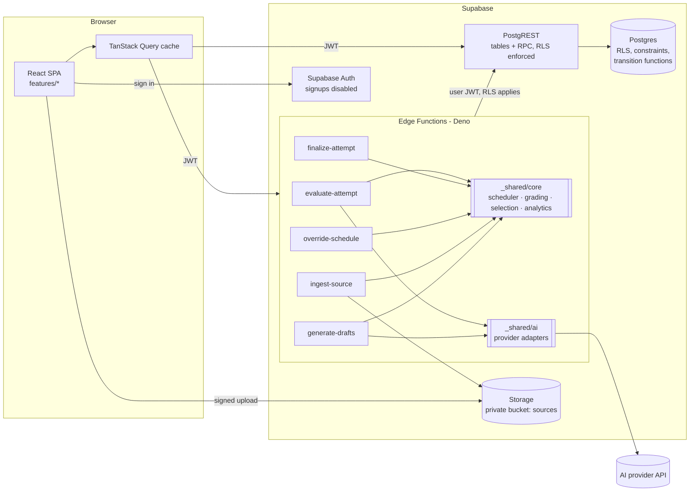
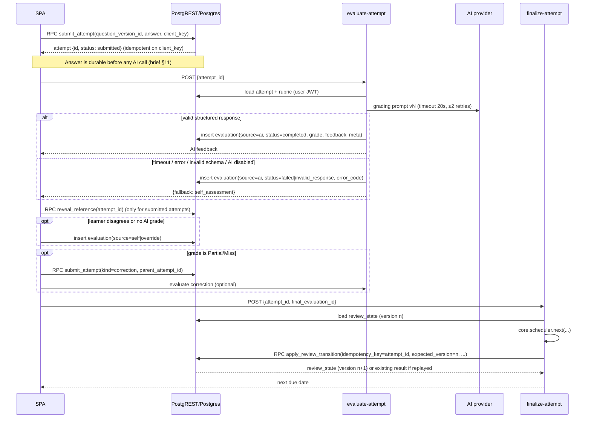

# System Architecture

**Status:** Draft for approval · Related ADRs: 0001–0009

## 1. Style

A **modular monolith** (ADR-0001) has three deployable pieces, all owned by this one codebase:

1. **SPA**: React + TypeScript + Vite, served as static files.
2. **Supabase project**: Postgres (with RLS), Auth, Storage, and Edge Functions (Deno/TypeScript).
3. **External AI provider**: called only from Edge Functions, behind a provider-agnostic interface.

No microservices. Edge Functions are thin entry points into the same domain core. They are not separately owned services.

## 2. High-level diagram



## 3. Component responsibilities

| Component | Location (planned) | Responsibility | Must NOT |
|---|---|---|---|
| Feature UI modules | `src/features/<feature>/` | Rendering, local UI state, calling hooks | Contain scheduling, grading, or analytics rules |
| Data hooks | `src/features/<feature>/api/` | TanStack Query hooks wrapping supabase-js and function calls; boundary validation with Zod | Hold business rules |
| Shared UI | `src/components/ui/` | shadcn/ui primitives and app-wide components | Know about domain entities |
| **Domain core** | `supabase/functions/_shared/core/` (aliased `@core` in the SPA; ADR-0002) | Pure TypeScript: scheduler, question selection scoring, grade normalization, mastery derivation, analytics formulas, Zod schemas, domain types | Do I/O, import Deno or browser APIs |
| AI adapters | `supabase/functions/_shared/ai/` | `EvaluationProvider` and `GenerationProvider` interfaces, provider adapters, versioned prompts, retries and timeouts | Leak provider types into the core |
| DB access (server) | `supabase/functions/_shared/db/` | Typed queries using the caller's JWT | Use the service-role key (SECURITY §5) |
| Edge Functions | `supabase/functions/<name>/` | Auth check → input validation → orchestration → persistence | Embed rules that belong in the core |
| Postgres | `supabase/migrations/` | Schema, constraints, RLS, **atomic transition functions** (`apply_review_transition`, etc.), reporting views | Re-implement scheduling math (the DB applies; the core computes) |
| Content-as-code | `content/catalog/<cert>/*.yaml` | Curated services, concepts, questions, citations (ADR-0007) | Contain secrets or user data |

### 3.1 Learning engine mapping (brief §7)

| Engine | Pure logic (core) | Orchestration | Persistence |
|---|---|---|---|
| Question Selection | `selection/score.ts`: priority score, filters, difficulty band | RPC `next_questions` returns candidates; core ranks client-side (read-only) | — |
| Evaluation Engine | `grading/normalize.ts`: rubric → grade mapping, confidence thresholds, override validation | `evaluate-attempt` | `evaluations`, `misconception_occurrences` |
| Correction Engine | `correction/plan.ts`: derive correction targets from missing points | `evaluate-attempt` (AI prompt) / static fallback | `attempts` (`kind = correction`) |
| Review Scheduler | `scheduler/next.ts`: `next(state, outcome, config, now, tz) → transition` | `finalize-attempt`, `override-schedule` | `apply_review_transition()` → `review_state`, `review_events` |
| Analytics | `analytics/*.ts`: formulas mirrored by SQL views; fixtures prove parity | RPC `dashboard_summary` | Views over history tables |

> **Selection is advisory.** It runs read-only, so running it in the browser is acceptable. Anything that **writes
> learning state** (finalization, scheduling, overrides) runs in an Edge Function and is applied atomically by Postgres.

## 4. Key data flows

### 4.1 Answer → evaluation → finalize → schedule



### 4.2 Content ingestion

```mermaid
sequenceDiagram
  participant UI as SPA
  participant ST as Storage (private)
  participant DB as Postgres
  participant ING as ingest-source
  participant GEN as generate-drafts
  participant AI as AI provider

  UI->>DB: create content_source(kind=user_upload, status=pending) + import_job(queued)
  UI->>ST: upload to sources/{user_id}/{source_id}.pdf (signed, size-capped)
  UI->>ING: POST {import_job_id}
  ING->>ST: read object; verify magic bytes, size, page count
  ING->>ING: extract text page by page (pdf.js-based, Deno)
  ING->>DB: insert source_passages (page, offsets, hash), job progress
  Note over ING: Large files are processed in page batches across invocations (job.cursor)
  UI->>GEN: POST {passage_ids[]}
  GEN->>AI: generation prompt (passages wrapped as untrusted data)
  GEN->>DB: insert service_concepts/questions with status=draft + concept_sources
  UI->>DB: owner reviews → RPC publish_concept(concept_id) validates citations
```

## 5. Authentication and authorization

- **Supabase Auth**, email + password (magic link optional). `enable_signup = false`. The owner account is created once via the CLI/dashboard.
- **SPA** uses the anon key plus the user session JWT. Every table has RLS. The anon role has no grants on app tables.
- **Edge Functions** create a Supabase client **with the caller's `Authorization` header**, so RLS applies to their reads and writes.
  The service-role key is not used by application code (SECURITY §5).
- **Roles:** the single user has `app_metadata.role = 'owner'`. Catalog writes (publish/approve) require `owner`.
  Learner-data policies require `user_id = auth.uid()`. This splits "content admin" from "learner" for future multi-user use without a redesign.

## 6. AI integration design

```ts
// _shared/ai/types.ts (illustrative; finalized in Phase 2)
interface EvaluationProvider {
  readonly id: string;                // "anthropic", "openai", "mock"
  evaluate(req: EvaluationRequest, opts: CallOptions): Promise<ProviderResult<RawEvaluation>>;
}
interface CallOptions { model: string; timeoutMs: number; signal?: AbortSignal }
type ProviderResult<T> =
  | { ok: true; value: T; usage: TokenUsage; latencyMs: number }
  | { ok: false; error: 'timeout' | 'rate_limited' | 'provider_error' | 'invalid_response' | 'refused'; retryable: boolean };
```

- **Structured output:** adapters request JSON (tool/function-calling or JSON mode, per provider). The result is **always** validated with the
  core Zod schema `EvaluationResult` (GRADING_RUBRICS §4). Adapter-native validation is not trusted on its own.
- **Prompt versioning:** prompts live in `_shared/ai/prompts/grading/v{N}.ts` with an exported `PROMPT_VERSION`. Changes create a new version and never edit in place.
- **Config:** `AI_PROVIDER`, `AI_MODEL_GRADING`, `AI_MODEL_GENERATION`, `AI_TIMEOUT_MS`, `AI_MAX_RETRIES`, and `AI_MONTHLY_BUDGET_USD` are Edge Function secrets/env. A per-user toggle lives in `user_settings`.
- **Retries:** exponential backoff with jitter (500 ms, 1500 ms), only for retryable errors, within an overall 30 s deadline.
- **Fallback:** any non-OK result → persist the failed evaluation row → the UI switches to self-assessment. No modal dead ends.
- **Metadata persisted:** provider, model, prompt_version, rubric_version (via `question_version_id`), latency, tokens, cost estimate, raw response (truncated, for audit), and error code.
- **Default provider:** the Anthropic adapter first (Q3). A `mock` adapter is used in all automated tests and can be selected locally.

## 7. Error handling and recovery

| Failure | Detection | Behavior | Data guarantee |
|---|---|---|---|
| Network drop before submit | fetch error | Draft kept in `localStorage` per question; retry button | Draft survives reload (per device) |
| Network drop during submit | timeout / unknown | Retry with the same `client_key` → idempotent | Exactly one attempt |
| AI timeout / 5xx / 429 | adapter result | Failed evaluation row; self-assessment offered; "Retry AI" allowed | Attempt intact |
| AI invalid JSON / schema mismatch | Zod | `invalid_response` row with truncated raw output | Attempt intact |
| AI budget exceeded | pre-call check | Skip the call; `status = skipped_budget` | Attempt intact |
| Finalize retried / double-clicked | `review_events.idempotency_key` unique | Returns the original transition | One event |
| Concurrent finalize (two tabs) | `review_state.version` check | Second call gets `409 conflict`; UI refetches | No lost update |
| Edge Function crash mid-ingest | job heartbeat stale > 2 min | Job marked `stalled`; resumable from `cursor` | Passages already written are kept (hash-deduped) |
| Malformed upload | validation | Job `failed` with typed `error_code` | Original object quarantined, then deleted after 7 days |

UI conventions: every query has explicit `loading`, `empty`, `error (with retry)`, and `success` states via a shared `<QueryBoundary>`.
Errors from functions use a single envelope (API_CONTRACTS §2).

## 8. Planned code layout

The skeleton now exists. See [DIRECTORY_STRUCTURE.md](DIRECTORY_STRUCTURE.md) for the full tree and the purpose of each folder.

```text
/
├── src/
│   ├── app/                 # router, providers, layout, auth guard
│   ├── features/
│   │   ├── dashboard/  services/  practice/  reviews/  content/  settings/  auth/
│   │   │   └── {components,api,hooks,routes}.ts(x)
│   ├── components/ui/       # shadcn/ui
│   └── lib/                 # supabase client, query client, env (Zod-validated)
├── supabase/
│   ├── config.toml
│   ├── migrations/          # timestamped SQL, forward-only
│   ├── seed.sql             # minimal; the catalog is loaded by script
│   ├── tests/               # pgTAP: RLS, constraints, transition functions
│   └── functions/
│       ├── _shared/{core,ai,db,http}/
│       └── evaluate-attempt/ finalize-attempt/ override-schedule/ ingest-source/ generate-drafts/
├── content/catalog/saa/     # YAML catalog (ADR-0007)
├── scripts/                 # catalog validate/import, type generation
├── tests/e2e/               # Playwright
└── docs/
```

## 9. Architecture Lab readiness (future)

Not built in the MVP. The plan reserves room for it:
- `services` and `service_relationships` (alternative_to, commonly_paired_with) already model swap candidates.
- `questions.question_type` is an enum that will gain `scenario` without changing the attempt/evaluation pipeline.
- Future tables are additive: `scenarios`, `scenario_layers`, `scenario_options` (DATA_MODEL §7).
