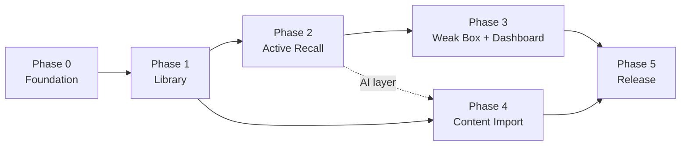

# Implementation Roadmap

**Status:** Draft for approval (checklist A10). No phase starts without explicit owner authorization.
Phase 0 starts only after the owner states: **"Architecture approved. Begin Phase 0."**

## 1. Phases

| Phase | Theme | Key deliverables | Depends on |
|---|---|---|---|
| [0](PHASE_0.md) | Engineering foundation | Repo, tooling, CI, local Supabase, auth shell, ADR-0002 spike | Approval |
| [1](PHASE_1.md) | Service Library | Catalog + content schema, RLS, catalog YAML pipeline, seed content, `/services` UI | 0 |
| [2](PHASE_2.md) | Active Recall | Learning schema, sessions, attempts, AI + self grading, overrides, corrections, finalize | 1 |
| [3](PHASE_3.md) | Weak Box | Scheduler, review state/events, due queries, overrides, misconceptions, dashboard | 2 |
| [4](PHASE_4.md) | Content Import | PDF upload/extract, passages, notes, draft generation, approval workflow | 1 (and the 2 AI layer) |
| [5](PHASE_5.md) | MVP Release | E2E golden path, security validation, a11y, responsive, backup, deploy | 0–4 |

## 2. Ordering conflict requiring a decision (Q8)

The brief's Recall workflow step 10 ("review scheduler determines the next review date") belongs to Phase 2, but the brief puts the scheduler in Phase 3.

| Option | Description | Trade-off |
|---|---|---|
| **A (recommended)** | Move only the **pure scheduler core + `apply_review_transition`** into the end of Phase 2. The Weak Box UI, due queries, overrides, misconceptions, and dashboard stay in Phase 3. | The golden path (DoD 1–8) works at the end of Phase 2. No throwaway code. Phase 2 grows by ~2 days. |
| B | Keep the brief's split. Phase 2 finalizes attempts without scheduling. Phase 3 adds the scheduler plus a one-time **replay backfill** of finalized attempts. | Matches the brief literally. The backfill code is used once. Phase 2 cannot demonstrate scheduling. |

The phase documents are written for **Option A**, with the moved items marked ⟵A.

## 3. Cross-phase rules

- Every phase ends with: acceptance tests green in CI, docs updated to match reality, a demo to the owner, and **explicit owner authorization** to continue.
- Migrations are additive per phase. Schema from earlier phases is changed only by expand → migrate → contract.
- Use a feature branch per phase and small PRs (≤ ~400 lines of diff where practical).
- No new runtime dependency without a one-line justification in the PR. Large ones need an ADR.

## 4. Testing strategy (summary; detail in operations/TESTING.md)

| Layer | Tool | Focus | Gate |
|---|---|---|---|
| Unit | Vitest | Core scheduler, grading derivation, selection, analytics, Zod schemas | Core ≥ 95% branch coverage |
| Component | Vitest + RTL | Feature components, loading/error/empty states, keyboard flows | Critical components covered |
| Database | pgTAP (`supabase test db`) + Vitest integration against local Supabase | RLS isolation, constraints, triggers, RPC idempotency, transitions | All tables covered by RLS tests |
| Contract | Vitest | Edge Function request/response vs Zod; AI adapter against recorded fixtures | All functions |
| E2E | Playwright | Golden path, AI-failure path, upload failures, a11y (axe) | Phase 5: all green on Chromium + WebKit mobile viewport |
| Calibration | Script | Grading prompt/model agreement on the labeled set | ≥ 90% agreement, 0 Pass↔Miss inversions |

## 5. Risk register

| # | Risk | Likelihood | Impact | Mitigation |
|---|---|---|---|---|
| R1 | Content authoring effort dominates (quality catalog is the product) | High | High | Start authoring in parallel with Phase 1. YAML templates. AI-assisted drafts (Phase 4) only with review. A smaller seed (e.g. 10 services) is acceptable for Phase 2. |
| R2 | AI grading inconsistency erodes trust | Medium | High | Deterministic grade derivation from rubric judgements, calibration set, visible confidence, one-key override, AI agreement metric |
| R3 | Edge Function limits break PDF extraction | Medium | Medium | Page batching with a cursor; size/page caps; spike at the start of Phase 4; fallback to in-browser pdf.js extraction with server re-validation |
| R4 | Deno/Node shared-code friction | Medium | Medium | ADR-0002 spike in Phase 0 with a defined fallback |
| R5 | Timezone/DST scheduling bugs | Medium | Medium | Injected clock, zone-aware calendar math, SR-11/12 tests |
| R6 | Scope creep (Architecture Lab, canvas, gamification) | Medium | Medium | PRD non-goals; changes go through the owner |
| R7 | AI cost overrun | Low | Medium | Budget cap + rate limit, cost recorded per evaluation, mock provider in dev and CI |
| R8 | Outdated AWS facts (limits change) | Medium | High | `retrieved_at` on citations and the 12-month staleness report |
| R9 | Supabase platform changes (CLI, Edge runtime) | Low | Medium | Pin CLI version; document the upgrade procedure |
| R10 | Losing learning history to a bad migration | Low | Critical | Append-only tables, forward-only migrations, pre-migration backup step, restore drill in Phase 5 |
| R11 | The exam guide changes (new SAA version) | Low | Medium | Certifications are versioned. Concepts are remapped, not rewritten. |
| R12 | A single-user app gets hosted with weak auth | Low | High | Signups disabled, MFA recommended, Phase 5 security gate |

## 6. Indicative effort (single developer + AI assistance)

| Phase | Estimate |
|---|---|
| 0 | 2–3 days |
| 1 | 4–6 days (plus content authoring in parallel) |
| 2 | 7–10 days |
| 3 | 5–7 days |
| 4 | 6–8 days |
| 5 | 3–5 days |

Estimates are planning aids, not commitments.
