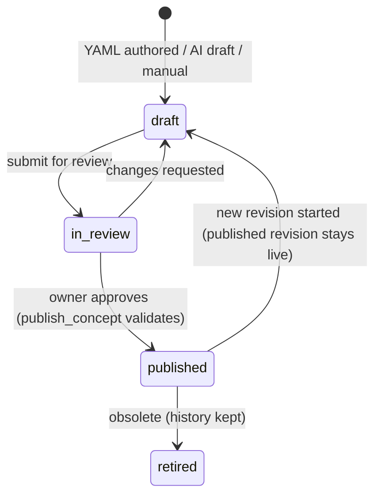

# Content Governance

**Status:** Draft for approval

## 1. Goals
Learning content must be **accurate, sourced, reviewed, and honest about where it came from**.
An incorrect "fact" drilled into muscle memory is worse than no fact.

## 2. Source trust tiers

| Tier (derived) | Source types | Badge | Can support a published concept on its own? |
|---|---|---|---|
| Official AWS | `aws_documentation`, `aws_whitepaper`, `aws_faq` | "AWS docs" | Yes |
| Curated | `curated` (owner-authored, in YAML) | "Curated" | Yes, when the YAML entry also cites an Official source for quantitative claims |
| Your notes | `user_note`, `user_upload` | "Your notes" | Yes for **private** concepts; the UI shows "Not verified against AWS docs" until an Official citation is added |

Rules:
- Quantitative claims (limits, quotas, durations, prices) require an Official citation with a `retrieved_at` date.
- The UI never renders a "Your notes" passage with AWS branding or styling.
- AWS documentation is cited as **URL + short excerpt** (≤ 4,000 chars per passage), not mirrored in full.

## 3. Lifecycle

- **AI-generated** content always starts as `draft` with `origin='ai_draft'` (CNT-6a). Practice never selects draft or in-review content.
- `publish_concept` validates: required fields present, ≥1 citation, all citations resolvable and owned or shared, every question has a schema-valid rubric with ≥1 critical point, and no unresolved placeholder text.
- Each publish writes an immutable `concept_revisions` snapshot.

## 4. Review checklist (shown in the UI on approval)
- [ ] Every factual claim is traceable to a cited passage
- [ ] Limits/quotas are cited to Official sources and dated
- [ ] A "what it does NOT do" statement is present and correct
- [ ] Questions are open-ended and not answerable by yes/no
- [ ] Rubric points are atomic facts; critical points are truly essential
- [ ] The reference answer is consistent with the rubric
- [ ] No content copied from the passages beyond short quotations

## 5. Import pipeline and error codes

| Stage | Checks | Error codes |
|---|---|---|
| Upload | Size ≤ 20 MB, magic bytes `%PDF-`, ≤10 uploads/day, duplicate sha256 | `file_too_large`, `unsupported_type`, `duplicate_source`, `rate_limited` |
| Parse | Not encrypted, ≥1 page, ≤300 pages | `pdf_encrypted`, `pdf_corrupt`, `pdf_too_many_pages` |
| Extract | Text found on ≥1 page | `no_extractable_text` (image-only; OCR is out of scope) |
| Segment | Passages of 500–2,000 chars on paragraph or heading boundaries; page and offset metadata; dedupe by hash | `segmentation_failed` |
| Generate | Passages wrapped as untrusted data; output schema-valid; citation ids ⊆ input ids | `ai_unavailable`, `ai_invalid_response`, `citation_mismatch` |

Text notes go through *Segment* and *Generate* only.

## 6. Prompt-injection posture for content
Passages are data. The generation prompt states this. The model has no tools. Output can only create draft rows linked to the job.
A fixture suite of hostile passages verifies that nothing else happens (CNT-9a).

## 7. Catalog freshness
Each Official citation stores `retrieved_at`. The content screen lists citations older than 12 months for re-verification. AWS limits change.

## 8. SAA seed scope (proposal, Q2)
About 25 services prioritized by exam frequency: IAM, VPC, EC2, Auto Scaling, ELB, S3, EBS, EFS, RDS, Aurora, DynamoDB, ElastiCache, Lambda, API Gateway,
SQS, SNS, EventBridge, Step Functions, CloudFront, Route 53, CloudWatch, CloudTrail, KMS, Cognito, ECS/Fargate.
Each has 5–10 concepts and ≥2 questions per concept. The domains are seeded from the **current published SAA exam guide**, verified at seed time.
